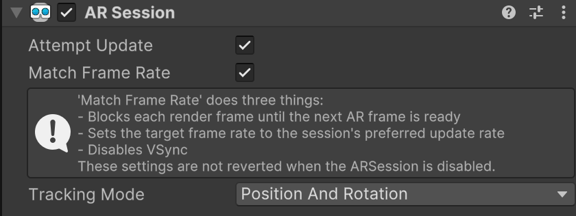

# AR Session component

Use the AR Session component to control the lifecycle of AR in your project.

The [ARSession](xref:UnityEngine.XR.ARFoundation.ARSession) component controls the lifecycle of an AR experience. On [non-OpenXR platforms](xref:arfoundation-manual#platforms), the `ARSession` component enables or disables AR on the target platform.

> [!NOTE]
> On [OpenXR platforms](xref:arfoundation-manual#platforms) (Meta Quest and Android XR), AR Foundation can't create or destroy the AR session. On these platforms, enabling or disabling the `ARSession` has no effect on enabling or disabling AR.

## Introduction to the AR session

A session refers to an instance of AR. While other features like plane detection can be independently enabled or disabled, the session controls the lifecycle of all AR features.

Enabling or disabling the `ARSession` on non-OpenXR platforms starts or stops the session, respectively. When you disable the AR Session components, the system no longer tracks features in its environment. Then if you enable it at a later time, the system attempts to recover and maintain previously detected features.

## Add the AR Session component

If you're starting your project from an [XR template](xref:um-xr-create-projects#templates) or an [AR Foundation sample](https://github.com/Unity-Technologies/arfoundation-samples), your project will already contain an `ARSession` in every scene.

To manually add the `ARSession` component to your scene, right click in the **Hierarchy** window, and select **XR** &gt; **AR Session**.

[!include]

## Component reference

 *AR Session component.*

You can configure the following settings in the **Inspector** window on [supported platforms](xref:arfoundation-session-platform-support#optional-feature-support):

| Property | Description |
| :------- | :---------- |
| **Attempt Update** | If enabled, the session will attempt to update a supported device if its AR software is out of date. |
| **Match Frame Rate** | If enabled, the Unity frame will be synchronized with the AR session. Otherwise, the AR session will be updated independently of the Unity frame. |

### Match frame rate

If you enable **Match Frame Rate**, the AR Session component configures the following settings:

1. Blocks each render frame until the next AR frame is ready.
2. Sets the target frame rate to the session's preferred update rate.
3. Disables VSync.

> [!NOTE]
> These settings aren't reverted when you disable the `ARSession`.

## Session state

It's important for your app to understand the AR Session state. All other AR Features depend on the AR Session and can't function properly until the session is tracking.

You can use [ARSession.state](xref:UnityEngine.XR.ARFoundation.ARSession.state) to get the current session state. You can also subscribe to the [ARSession.stateChanged](xref:UnityEngine.XR.ARFoundation.ARSession.stateChanged) event to receive a callback when the state changes. The following table lists all possible session states:

| Session state | Description |
| :------------ | :---------- |
| [None](xref:UnityEngine.XR.ARFoundation.ARSessionState.None) | AR has not been initialized and availability is unknown. |
| [Unsupported](xref:UnityEngine.XR.ARFoundation.ARSessionState.Unsupported) | The device does not support AR. |
| [CheckingAvailability](xref:UnityEngine.XR.ARFoundation.ARSessionState.CheckingAvailability) (Deprecated) | The session subsystem is currently checking availability of AR on the device. This state is only set by the deprecated [CheckAvailability](xref:UnityEngine.XR.ARFoundation.ARSession.CheckAvailability) API. |
| [NeedsInstall](xref:UnityEngine.XR.ARFoundation.ARSessionState.NeedsInstall) (Deprecated) | The device supports AR, but requires additional software to be installed. This state is only set by the deprecated [CheckAvailability](xref:UnityEngine.XR.ARFoundation.ARSession.CheckAvailability) API. To install required AR software, use `TryInstallAsync` on the platform-specific session subsystem, or pass [InstallSoftwareIfNeeded](xref:UnityEngine.XR.ARSubsystems.XRSubsystemStartOptions.InstallSoftwareIfNeeded) to `TryStartAsync`. |
| [Installing](xref:UnityEngine.XR.ARFoundation.ARSessionState.Installing) (Deprecated) | AR software is currently installing. This state is only set by the deprecated [Install](xref:UnityEngine.XR.ARFoundation.ARSession.Install) API. |
| [Ready](xref:UnityEngine.XR.ARFoundation.ARSessionState.Ready) | The device supports AR, and any necessary software is installed. This state will automatically change to either `SessionInitializing` or `SessionTracking`. |
| [SessionInitializing](xref:UnityEngine.XR.ARFoundation.ARSessionState.SessionInitializing) | The AR session is currently initializing. This usually means AR is running, but not yet tracking successfully. |
| [SessionTracking](xref:UnityEngine.XR.ARFoundation.ARSessionState.SessionTracking) | The AR session is running and tracking successfully. The device is able to determine its position and orientation in the world. If tracking is lost during a session, this state may change to `SessionInitializing`. |

> [!NOTE]
> The availability check and install workflow based on [CheckAvailability](xref:UnityEngine.XR.ARFoundation.ARSession.CheckAvailability) and [Install](xref:UnityEngine.XR.ARFoundation.ARSession.Install), along with the `CheckingAvailability`, `NeedsInstall`, and `Installing` states, is deprecated as of AR Foundation 6.7. To install required AR software, pass [InstallSoftwareIfNeeded](xref:UnityEngine.XR.ARSubsystems.XRSubsystemStartOptions.InstallSoftwareIfNeeded) to `TryStartAsync`, or call `TryInstallAsync` on the platform-specific session subsystem. Refer to [Install XR software on mobile devices](xref:arfoundation-session-platform-support#install) for more information.
