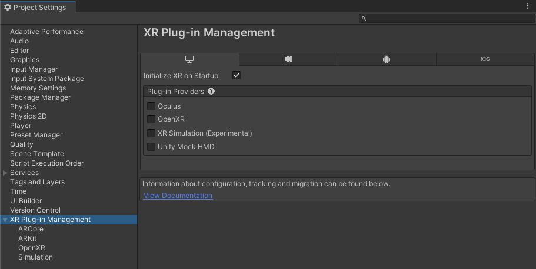

# Install AR Foundation

AR Foundation is an official Unity package available via the [Package Manager](https://learn.unity.com/tutorial/the-package-manager).

## Editor compatibility

AR Foundation 7.0 is compatible with Unity 7 (7000.0) or newer.

### Older Editor versions

If your project requires an older version of the Editor, you can use one of the supported versions of AR Foundation in the following table.

| Editor version | AR Foundation version |
| :------------: | :-------------------: |
|     6000.0 LTS |          6.0          |
|     6000.3 LTS |          6.3          |
|     6000.7 LTS |          6.7          |

# Required packages

The AR Foundation package contains interfaces for AR features, but doesn't implement any AR features itself. To use AR Foundation on a target platform, you also need a separate *provider plug-in* package for that platform. A provider plug-in is a separate package containing AR Foundation feature implementations for a given platform.

Unity officially supports the provider plug-ins in the following table with this version of AR Foundation.

| Platform         | Plug-in | Version |
| :--------------- | :------ | :------ |
| **Android**      | [Google ARCore XR Plug-in](xref:arcore-manual) | 7.0 |
| **iOS**          | [Apple ARKit XR Plug-in](xref:arkit-manual) | 7.0 |
| **visionOS**     | [Apple visionOS XR Plug-in](https://docs.unity3d.com/Packages/com.unity.xr.visionos@latest) | 3.1 |
| **Meta Quest**   | [Unity OpenXR: Meta](xref:meta-openxr-manual) | 7.0 |
| **Android XR**   | [Unity OpenXR: Android XR](xref:androidxr-openxr-manual) | 7.0 |
| **Meta Quest** or **Android XR** | [Unity OpenXR: Spatial Entities](xref:spatialentities-openxr-manual) | 7.0 |

To use AR Foundation on a device, you must install at least one provider plug-in, either from the Package Manager or by going to **Project Settings** > **XR Plug-in Management** as shown below.

 *XR Plug-in Management*

> [!NOTE]
> Google also maintains a separate product, [ARCore Extensions for AR Foundation](https://developers.google.com/ar/develop/unity-arf), that you can use to access additional ARCore capabilities.

## Provider project settings

Some provider plug-ins require that you set specific project settings for AR to function properly. Refer to each provider's documentation, listed in the following table, for specific instructions.

| Provider plug-in | Setup instructions |
| :--------------- | :----------------- |
| [Google ARCore XR Plug-in](xref:arcore-manual) | [Project configuration](xref:arcore-project-config) (ARCore) |
| [Apple ARKit XR Plug-in](xref:arkit-manual) | [Project configuration](xref:arkit-project-config) (ARKit) |
| [Unity OpenXR: Meta](xref:meta-openxr-manual)| [Get started](xref:meta-openxr-get-started) (OpenXR Meta) |
| [Unity OpenXR: Android XR](xref:androidxr-openxr-manual) | [Get started](xref:androidxr-openxr-get-started) (Android XR) |
| [Unity OpenXR: Spatial Entities](xref:spatialentities-openxr-manual) | [Get started](xref:spatialentities-openxr-get-started) (Spatial Entities) |

## Third-party plug-ins

It is possible to develop custom provider plug-ins for AR Foundation. If you are using a third-party provider plug-in, refer to third-party documentation for more specific instructions regarding installation and use.

[!include]
